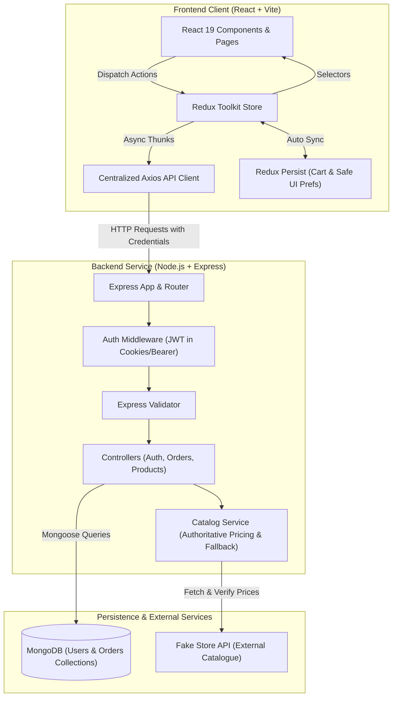
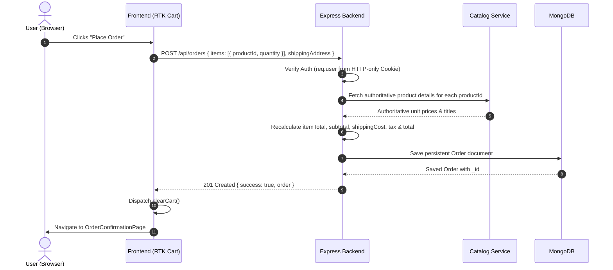

# ShopSphere Architecture & Design Document

An in-depth guide to the technical design, architectural patterns, state management, and security model of **ShopSphere**.

---

## 1. High-Level Architecture Overview

ShopSphere follows a clean, decoupled **MERN (MongoDB, Express, React, Node.js)** architecture:

---

## 2. Redux Toolkit Architecture

State management is centralized with **Redux Toolkit (RTK)** to avoid prop drilling and guarantee consistent state:

### Slice Breakdown
1. **`productsSlice`**:
   * Uses `@reduxjs/toolkit`'s `createEntityAdapter()` for normalized product indexing (`ids`, `entities`).
   * Manages filtering state (`searchTerm`, `selectedCategory`, `minPrice`, `maxPrice`) and sorting options.
   * Exports memoized derived selector `selectFilteredAndSortedProducts` built via `createSelector()`.
2. **`cartSlice`**:
   * Manages cart items array `[{ id, title, price, image, category, quantity }]`.
   * Enforces business constraints: items cannot drop below quantity 1.
   * Exports memoized selectors for `selectCartItemCount`, `selectCartSubtotal`, `selectCartEstimatedShipping` (free on orders >= $100), `selectCartEstimatedTax` (8%), and `selectCartEstimatedTotal`.
3. **`authSlice`**:
   * Tracks authenticated user profile, session initialization, and request states.
   * Driven by asynchronous thunks: `checkAuthSession`, `loginUser`, `registerUser`, `logoutUser`.
   * Strictly exempt from browser local storage persistence (security safeguard).
4. **`ordersSlice`**:
   * Handles user's placed orders, current active order invoice, and creation lifecycles.
5. **`preferencesSlice`**:
   * Stores theme, grid/list view mode, and items per page.

### Redux Persist Boundary
* **Persisted**: `cart`, `preferences`.
* **Excluded**: `auth`, `products`, `orders`.
* **Rationale**: Storing authentication credentials or authorization tokens in `localStorage` exposes users to XSS attacks. Instead, authentication relies on secure HTTP-only cookies and backend `/api/auth/me` session restoration on application startup.

### Development Diagnostic Middleware
A custom logger middleware (`src/app/loggerMiddleware.js`) intercepts dispatched actions in development mode, measuring execution latency and logging state diffs while strictly scrubbing passwords, tokens, and personal credentials.

---

## 3. Authoritative Order Recalculation Model

A core security mandate of ShopSphere is: **Never trust client-supplied prices or totals.**

* Even if a malicious user alters prices in the client-side DOM or Redux state, the backend retrieves verified prices from `catalogService`, checks quantity integers, calculates tax and shipping rules on the server, and persists only the authoritative amounts.

---

## 4. Backend Architecture & Security Safeguards

### Database Models (Mongoose)
1. **`User`**:
   * Normalizes emails to lowercase, trimmed.
   * Uses `bcryptjs` with salt rounds = 10 for one-way password hashing.
   * `select: false` on `passwordHash` and JSON transformation to ensure password hashes are never leaked.
2. **`Order`**:
   * Stores item snapshots (title, authoritative price at time of purchase, image, category).
   * Relates directly to `user` (`ObjectId` ref: 'User') with compound index.
   * Validates positive integer quantities and currency precision (`pre('validate')`).

### Security Middleware Stack
* **Helmet**: Configures CSP, HSTS, cross-origin resource policy, and frame protection.
* **CORS**: Explicitly restricted to configured frontend origins with `credentials: true`.
* **Rate Limiting**: `express-rate-limit` throttles authentication endpoints (`/api/auth/login`, `/api/auth/register`) to 30 requests per 15 minutes to deter brute-force credential stuffing.
* **HTTP-Only Cookies**: Authentication JWT tokens are stored with `httpOnly: true`, `sameSite: 'lax'` (or `'strict'` in production), and `secure: true` in HTTPS environments.
* **Order Isolation**: The order details controller strictly checks `order.user.toString() === req.user._id.toString()`. If a user attempts to look up an order ID belonging to another user, the request is immediately rejected with `403 Forbidden`.

